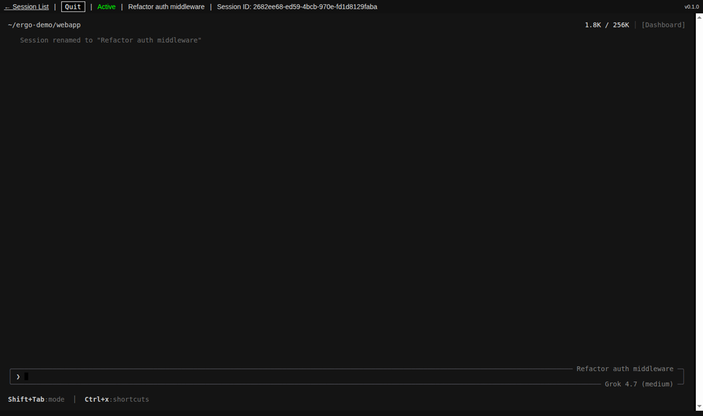
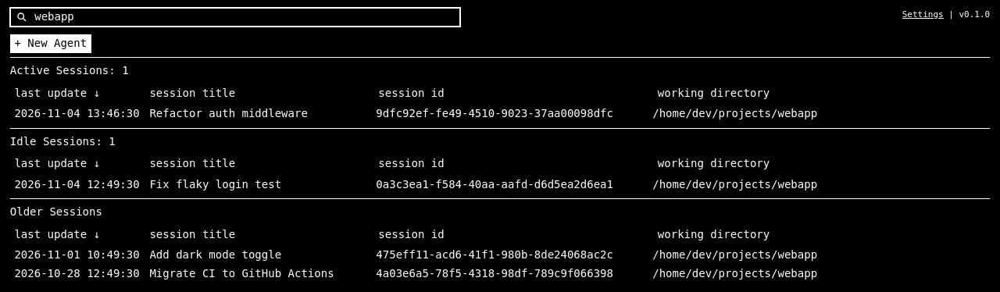
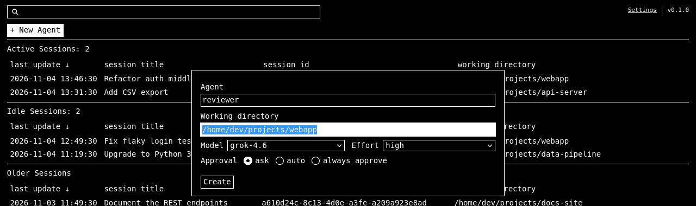
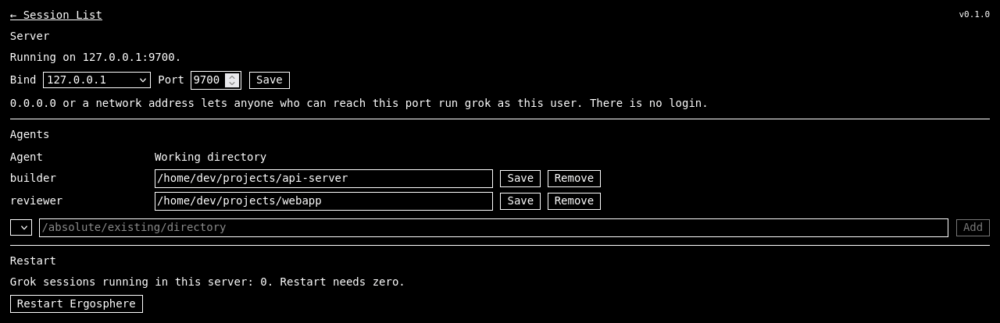
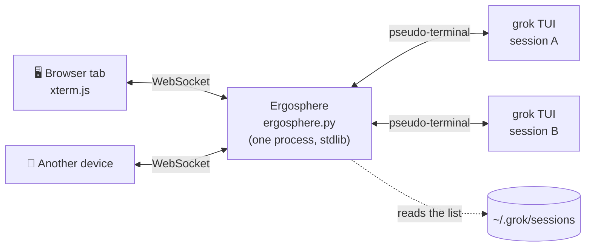

<p align="center">
  
</p>

<p align="center">
  <a href="LICENSE"></a>
  
  
  
  <a href="https://x.ai/news/grok-build-cli"></a>
  
</p>

<h3 align="center">Close the laptop. grok keeps going. Pick it up from any browser.</h3>

<p align="center">
  <a href="#-quick-start"><b>Quick start</b></a> ·
  <a href="#-features"><b>Features</b></a> ·
  <a href="#-screenshots"><b>Screenshots</b></a> ·
  <a href="#-how-it-works"><b>How it works</b></a> ·
  <a href="#-remote-access"><b>Remote access</b></a> ·
  <a href="#-faq"><b>FAQ</b></a> ·
  <a href="#-roadmap"><b>Roadmap</b></a>
</p>

**Ergosphere is a local web portal for [Grok CLI](https://x.ai/news/grok-build-cli). It lists every grok session on your machine and opens each one as the real `grok` TUI in your browser.**

> [!NOTE]
> **Why "Ergosphere"?** An *ergosphere* is the region just outside a spinning black hole where nothing can stand still, yet you can still get out. Ergosphere is that region for **Grok**: your grok sessions keep spinning on your machine, and you drop in and out of them from any browser. Ergosphere is a companion to xAI's [Grok CLI](https://x.ai/news/grok-build-cli): it runs the real `grok` program and needs grok installed and signed in. It is an independent open-source project, not made by or affiliated with xAI.

Not a chat clone, and not a wrapper that guesses at grok's output. Every session page *is* the interactive `grok` program, running in a pseudo-terminal on your machine and streamed to [xterm.js](https://github.com/xtermjs/xterm.js). Slash commands, permission prompts and every key you know work exactly as they do in your shell. **Close the tab and grok keeps working.** Open it again from your laptop, your desktop or your phone and you are back in the same live process.

> **One Python file. Standard library only. One line to install.**

```bash
curl -fsSL https://raw.githubusercontent.com/JuliusPIV/ergosphere/main/install.sh | bash
```

<p align="center">
  
  <br><sub><i>The real grok TUI, in a browser tab. The bar on top is Ergosphere: status, session name, session ID and Quit.</i></sub>
</p>

---

## 🤔 Why Ergosphere?

You started a long grok task over SSH. Now you want to check on it from another room, another machine, or your phone. Your options today:

| | Plain SSH terminal | SSH + tmux | **Ergosphere** |
|---|:---:|:---:|:---:|
| grok keeps running when you disconnect | ❌ | ✅ | ✅ |
| Open a session from any browser, phone included | ❌ | ❌ | ✅ |
| Every session in one searchable list | ❌ | ❌ | ✅ |
| Start a session with agent, folder, model and effort picked from a dialog | ❌ | ❌ | ✅ |
| Never starts a second grok for a session that is already running | ❌ | ❌ | ✅ |
| Take over a session that a terminal on the same machine is holding | ❌ | ❌ | ✅ |
| Mouse, copy and paste that just work | ✅ | ⚠️ | ✅ |
| Only a browser needed on the client (on a trusted network, or with an SSH tunnel) | ❌ | ❌ | ✅ |

---

## 🚀 Quick start

**1. Install and start it.**

```bash
curl -fsSL https://raw.githubusercontent.com/JuliusPIV/ergosphere/main/install.sh | bash
```

With a terminal it asks `Automatic (recommended) or Manual? [A/m]`. **Automatic** asks nothing else: it installs to `~/.local/share/ergosphere`, listens on `127.0.0.1` port `9241`, starts the server and prints a summary.

**2. Open it.** On the same machine, go to **http://localhost:9241/**. From another computer, see [Remote access](#-remote-access).

**3. Work.** Pick a session and press <kbd>Enter</kbd>, or press <kbd>Alt</kbd>+<kbd>N</kbd> to start a new one.

<details>
<summary><b>Pick the directory, port and listen address yourself</b></summary>

<br>

Manual mode asks for the install directory, port, listen address, an optional first agent and whether to start on boot:

```bash
curl -fsSL https://raw.githubusercontent.com/JuliusPIV/ergosphere/main/install.sh | bash -s -- --manual
```

Or set them on the command line:

```bash
# A different port, still this machine only
curl -fsSL https://raw.githubusercontent.com/JuliusPIV/ergosphere/main/install.sh | bash -s -- --port 9300

# Listen on one network address of this machine
curl -fsSL https://raw.githubusercontent.com/JuliusPIV/ergosphere/main/install.sh | bash -s -- --bind 192.0.2.10 --yes

# Start at login (and at boot with lingering), restart on crash or hang (systemd user unit)
curl -fsSL https://raw.githubusercontent.com/JuliusPIV/ergosphere/main/install.sh | bash -s -- --service
```

All options are in the [installer reference](#installer-options).

</details>

---

## ✨ Features

<table>
<tr><td width="34%">🖥️ <b>The real grok TUI</b></td><td>Each session is the interactive <code>grok</code> program in a pseudo-terminal, drawn by xterm.js. Every grok key and slash command works. Nothing is re-implemented.</td></tr>
<tr><td>♾️ <b>Sessions outlive the tab</b></td><td>Closing the tab does not stop grok. Reattach from any browser or device that reaches the same Ergosphere, and the screen is redrawn exactly as grok has it. Every view of a session shares one live process.</td></tr>
<tr><td>🔒 <b>One grok per session, never two</b></td><td>Ergosphere never starts a second grok for a session that is already running. Opening it again attaches to the one that exists.</td></tr>
<tr><td>🗂️ <b>Every session at a glance</b></td><td>The session list groups sessions into <b>Active</b>, <b>Idle</b> and <b>Older</b>. Type in the filter box and the list narrows as you type, by title, session ID or working directory.</td></tr>
<tr><td>⚡ <b>New sessions in one dialog</b></td><td>Pick the agent, working directory, model and reasoning effort, then <b>Ask</b>, <b>Auto</b> or <b>Always approve</b>. The dialog remembers the last model and effort you used.</td></tr>
<tr><td>🔁 <b>From the CLI to the browser</b></td><td>Started a session in a terminal? When a grok CLI on the same machine holds it, the page offers <b>Quit that CLI and resume here</b>.</td></tr>
<tr><td>🛡️ <b>Safe resume</b></td><td>A stopped session always resumes in <b>Ask</b> mode, whatever mode it had before. Switch to Auto or Always approve in the TUI when you want them.</td></tr>
<tr><td>🏷️ <b>Knows its name</b></td><td>The chat bar shows the session name before its ID and follows <code>/rename</code> within a few seconds. The browser tab title matches.</td></tr>
<tr><td>📋 <b>Copy and paste that behave</b></td><td><kbd>Ctrl</kbd>+<kbd>C</kbd> copies a selection and otherwise interrupts grok, like a terminal. <kbd>Ctrl</kbd>+<kbd>V</kbd> pastes. Copying works on plain HTTP pages too.</td></tr>
<tr><td>🖱️ <b>Mouse included</b></td><td>The mouse wheel and clicks reach grok. Drag to select text.</td></tr>
<tr><td>⚙️ <b>Settings without editing files</b></td><td>A Settings page changes the listen address and port, and adds, changes or removes agents and their working directories. A port already in use is refused, and if the new address cannot be used at restart, Ergosphere falls back to the previous one.</td></tr>
<tr><td>🧱 <b>Safe by default</b></td><td>Listens on 127.0.0.1 only. Checks Host and Origin, refuses to be framed, and a foreign website cannot start sessions. Only a button on an Ergosphere page (<b>Create</b>, <b>Resume</b>, or <b>Quit that CLI and resume here</b>) starts grok; opening a link never does.</td></tr>
<tr><td>📦 <b>One-line installer</b></td><td>Checks prerequisites, installs, starts and reads everything back. Safe to run again: it replaces only files that changed.</td></tr>
</table>

### ⌨️ Keyboard

| Where | Keys | Does |
|---|---|---|
| Session list | <kbd>↑</kbd> <kbd>↓</kbd> | Select a session |
| Session list | <kbd>Enter</kbd> | Open it |
| Session list | <kbd>Ctrl</kbd>+<kbd>Enter</kbd> | Open it in a new tab |
| Session list | <kbd>Alt</kbd>+<kbd>N</kbd> | New session |
| Session | <kbd>Ctrl</kbd>+<kbd>C</kbd> | Copy the selection, or interrupt grok when nothing is selected |
| Session | <kbd>Ctrl</kbd>+<kbd>Shift</kbd>+<kbd>C</kbd> | Copy the selection |
| Session | <kbd>Ctrl</kbd>+<kbd>V</kbd> | Paste |
| Session | everything else | Goes straight to grok |

---

## 📸 Screenshots

<table>
<tr>
<td width="50%" valign="top">

<p align="center"><b>Session list</b><br><sub>Active, Idle and Older, filtered as you type.</sub></p>
</td>
<td width="50%" valign="top">

<p align="center"><b>New session</b><br><sub>Agent, folder, model, effort and approval mode.</sub></p>
</td>
</tr>
<tr>
<td colspan="2">

<p align="center"><b>Settings</b><br><sub>Listen address, port and agents, changed live.</sub></p>
</td>
</tr>
</table>

---

## 🧭 How it works



- **Ergosphere owns the terminals, not the browser.** Each grok runs in a pseudo-terminal held by the server, so a tab can close, crash or move to another device without grok noticing.
- **Every browser view attaches to the same process.** Two tabs on one session type into the same grok and see the same output; the terminal takes the size of whichever tab resized last.
- **Reattach redraws the real screen.** On attach, Ergosphere replays recent output and then has grok repaint every cell, so what you see is exactly what grok has.
- **The session list comes from grok's own files** in `~/.grok/sessions`, so sessions you started in a terminal show up too.
- **No framework, no build step, no database.** The terminal is a vendored copy of xterm.js; everything else is the Python standard library.

---

## 📋 Requirements

| Requirement | Details |
|---|---|
| 🐧 **Linux** | Tested on Ubuntu 24.04 LTS. |
| 🐍 **Python 3** | Tested on 3.12. Standard library only: no pip, no virtualenv. |
| 🤖 **grok** | Tested on 1.0.70. On `PATH` and already signed in as the user that runs Ergosphere. |
| 🧰 **Installer tools** | Bash, curl, tar, gzip, nohup, sha256sum. Git is not needed. |
| 🪟 **Windows** | Should run inside [WSL2](https://learn.microsoft.com/en-us/windows/wsl/install), with Python and the Linux grok inside the distro. Untested. |
| 🍎 **macOS** | Not supported yet. Ergosphere reads Linux's `/proc` to track grok processes, and the installer requires Linux. macOS support is [being explored](#-roadmap). |

Ergosphere does not install grok and does not handle grok sign-in. Sessions come from `~/.grok/sessions` and agents from `~/.grok/agents` (or `GROK_AGENTS_DIR`), so run Ergosphere as the user who owns them.

---

## 🌐 Remote access

By default Ergosphere listens on `127.0.0.1`, so only the machine it runs on can open it. Two ways to reach it from elsewhere:

**Option A: SSH tunnel (recommended).** Nothing new is exposed to the network. On your own computer run:

```bash
ssh -N -L 9241:127.0.0.1:9241 you@your-server
```

Then open http://localhost:9241/. The install summary prints the exact command for your server.

**Option B: listen on the network.** Install with `--bind 0.0.0.0 --yes` for every address of the machine, or `--bind 192.0.2.10 --yes` for one address. Manual mode asks the same question, and the Settings page can change it later. The install summary prints the URLs that reach it.

> [!WARNING]
> **Ergosphere v0.1 has no login. Anyone who can reach the port can run grok as the user that runs Ergosphere.** Only listen on a trusted network, or put a firewall or VPN in front of it.

### 🛡️ Security model at a glance

| Threat | v0.1 |
|---|---|
| A random website you visit tries to start or drive grok | **Blocked.** Host and Origin are checked, the page cannot be framed, and only a button on an Ergosphere page (Create, Resume, or Quit that CLI and resume here) starts grok. Opening a link never does. |
| A crafted link opens a session page | **Nothing starts.** A link only shows the page; a stopped session waits for your Resume click. |
| Someone on the network reaches the port | **Not protected.** There is no login in v0.1. Keep the default `127.0.0.1` or use an SSH tunnel, firewall or VPN. |
| Another local user on the same machine | **Not protected.** Loopback is shared by local users and containers. |
| A reverse proxy with its own login | **Supported** with a bearer token. See [behind a reverse proxy](#advanced-behind-a-reverse-proxy). |

---

## ❓ FAQ

<details>
<summary><b>Does closing the tab stop my session?</b></summary>

No. grok keeps running. Open the session again from any browser that reaches the same Ergosphere and you are back in the same process. The **Quit** button in the chat bar stops it.
</details>

<details>
<summary><b>I have the same session open in a terminal. What happens?</b></summary>

Ergosphere will not start a second grok for it. When a grok CLI on the same machine holds the session, the page says so and offers **Quit that CLI and resume here**.
</details>

<details>
<summary><b>Can two browsers show the same session?</b></summary>

Yes. Both attach to the same live grok.
</details>

<details>
<summary><b>Why did my session come back in Ask mode?</b></summary>

On purpose. A stopped session always resumes in Ask, so nothing runs without your approval until you choose otherwise in the TUI.
</details>

<details>
<summary><b>What happens when Ergosphere stops?</b></summary>

The grok sessions it started stop with it. Saved sessions stay in `~/.grok/sessions` and resume from the list.
</details>

<details>
<summary><b>Does it start at boot?</b></summary>

Only if you ask for it. On Linux with a systemd user manager, install with `--service` (or answer yes in manual mode) and the installer writes and enables a user unit, `~/.config/systemd/user/ergosphere.service`. It starts Ergosphere when you log in and restarts it if it crashes or hangs: the server pings the systemd watchdog only while it can answer its own `/health`, so a hung server is killed and started again within a minute.

To start it at boot, before you log in, turn on lingering once: `loginctl enable-linger $USER` (it may need `sudo`). The installer prints this line but does not run it.

Without `--service`, run the installer again to start it after a reboot. A rerun reuses a running server and replaces only files that changed.
</details>

<details>
<summary><b>How do I stop or remove it?</b></summary>

The install summary prints the process ID and a `kill <pid>` command. With `--service` it prints `systemctl --user stop ergosphere` instead: under the unit, `kill` only restarts it. To remove the unit, rerun the installer with `--no-service`. To remove Ergosphere, stop it (and remove the unit) and delete the install directory.
</details>

<details>
<summary><b>Does it need a login?</b></summary>

grok must already be signed in on the server. Ergosphere itself has no login in v0.1, which is why it listens on 127.0.0.1 by default.
</details>

<details>
<summary><b>Does it work on macOS?</b></summary>

Not yet. Ergosphere reads Linux's `/proc` to find grok processes and keep one per session, and the installer uses Linux-only tools. It needs a small port to macOS process tools (`ps`, `lsof`). That is on the [roadmap](#-roadmap).
</details>

<details>
<summary><b>I see "Server error (500) | Retrying (attempt N)" in a session. Is Ergosphere broken?</b></summary>

No. That message comes from grok itself: xAI's servers returned an error and grok is retrying the request. Ergosphere only shows grok's screen, so you would see the same message running grok in a terminal. If it keeps retrying, wait and try again later.
</details>

<details>
<summary><b>In Microsoft Edge, a small blue dot appears on the cursor and jumps around. What is it?</b></summary>

That dot is Edge's writing-assistance hint, not part of grok or Ergosphere. Edge shows it on the cursor of the focused text field, and the terminal keeps a hidden text field at its cursor, so the dot follows the cursor as grok redraws. Ergosphere tells Edge not to show writing assistance in the terminal. If you still see it, update Ergosphere, or turn it off in Edge: **Settings > Languages > Writing assistance > Show writing hints**. Chrome and Firefox do not show it.
</details>

---

## 📍 Roadmap

Plans, not promises. Items are ordered roughly by priority, and each one is tagged with its type.

**Types:** 🐛 Bug fix · 🔐 Security · ✨ Enhancement · 🛋️ Quality of life · 🧭 Usability · 💻 Platform

### 🔜 Next up

| Item | Type | What changes |
| --- | --- | --- |
| **Smaller "Resume this session" prompt** | 🧭 Usability | The prompt shown for a stopped session takes less of the screen. |
| **Resume prompt opens by itself** | 🧭 Usability | Opening a stopped session shows the resume prompt straight away instead of an empty terminal. |
| **Resume on click, as a setting** | ✨ Enhancement | An option in Settings resumes a stopped session as soon as you open it. |
| **Sessions whose folder was deleted** | 🐛 Bug fix | The list marks them and explains why they cannot resume, and offers another folder, instead of failing with an error. |

### 🗓️ Planned

| Item | Type | What changes |
| --- | --- | --- |
| **Local models** | ✨ Enhancement | Run sessions on local models, starting with llama.cpp, with a Cloud / Local choice in the new-session dialog. |
| **Browser login** | 🔐 Security | Sign in to Ergosphere, so it can be reached without an SSH tunnel. |
| **Disconnect or Quit** | 🧭 Usability | Leave a session running and close the page, or stop grok, from one clear dialog. |
| **Takeover prompt** | 🧭 Usability | When a session is open in a terminal or another browser, a prompt offers to move it here. |
| **Consistent theming** | 🧭 Usability | One consistent look across the list, the session page and Settings. |
| **Thinking and tools view** | ✨ Enhancement | A separate panel for grok's thinking, commands and skills. |
| **More installer port presets** | 🛋️ Quality of life | Pick 8080 or 8081 in the installer as well as 9241. |

### 🔭 Exploring

| Item | Type | What changes |
| --- | --- | --- |
| **Sessions survive Ergosphere updates** | ✨ Enhancement | Update the web server without stopping the grok sessions it runs. |
| **Turn notifications** | ✨ Enhancement | A browser notification when grok finishes a turn (needs HTTPS). |
| **macOS support** | 💻 Platform | Ergosphere on macOS, replacing the Linux-only process checks. |
| **More themes** | ✨ Enhancement | Pick from several looks once theming is consistent. |

Have an idea or found a bug? [Open an issue](https://github.com/JuliusPIV/ergosphere/issues).

---

## 📚 Reference

### Installer options

Pass options after `| bash -s --`.

| Option | Meaning |
|---|---|
| `--auto` | Automatic: no questions. Also the mode when there is no terminal. |
| `--manual` | Ask for the install directory, port, listen address, an optional agent and, with a systemd user manager, whether to start on boot. |
| `--dir DIR` | Install directory. Default `~/.local/share/ergosphere`. |
| `--port N` | Port. Default `ERGOSPHERE_PORT`, else the port saved in `ergosphere.json`, else `9241`. |
| `--bind ADDR` | Listen address: an IPv4 address of this machine, `0.0.0.0`, or `localhost`. Default: the address saved in `ergosphere.json`, else `127.0.0.1`. |
| `--service` | Run it as a systemd user unit, `ergosphere.service` (`Type=notify`, `WatchdogSec=60`, `Restart=always`, `RestartSec=5`, `WantedBy=default.target`), and enable it: it starts at login, at boot with `loginctl enable-linger`, and restarts if it crashes or hangs. A rerun without the flag keeps the unit and updates it when it differs. With a release that has no watchdog support (`--version` v0.1.3 or older) the unit is `Type=simple` without `WatchdogSec`: it restarts after a crash, not a hang, and the summary says so. Never touches system units or a unit from another install. |
| `--no-service` | Stop, disable and remove that unit (only when it has no grok sessions open); Ergosphere then runs without systemd. |
| `--yes` | Approve a listen address other than loopback without asking. |
| `--version vA.B.C` | Install that release instead of the latest one (pin or roll back). The rerun command it prints keeps it. |
| `--check` | Run the checks only. Change nothing. |
| `--help` | Show the options. |

Prerequisites are checked first and listed when missing. The installer never installs them, and it does not check grok sign-in.

**The installer refuses:**

- a port below 1024 when not run as root;
- a listen address that is not one of this machine's addresses;
- a non-empty directory that is not an Ergosphere install;
- a port already in use by anything else, including an Ergosphere from a different install directory (that one is left running).

A failure prints `failed at check|download|install|start: ...` and exits 1.

**Reruns are safe.** Each run compares installed files by sha256 and replaces only those that differ. `ergosphere.json` is kept: agents and the remembered model and effort stay as they are, and `--bind` and `--port` (or `ERGOSPHERE_PORT`) change only those two keys. A running server from the same directory is reused. When its code changed, its address changed or an agent was added, it is restarted only if it has no grok sessions open. If sessions are open, it keeps running and the summary says how to finish the change.

The summary lists the URL, listen address, port, install directory, configuration and agents, log, process ID, the stop command, a `rerun:` line with your settings, what changed, and how to reach the page from another computer.

### Configuration

Everything lives in one file, `ergosphere.json`, next to `ergosphere.py`. The Settings page edits it for you; [`ergosphere.example.json`](ergosphere.example.json) shows the shape:

```json
{"bind": "127.0.0.1", "port": 9241, "agents": {"my-agent": "/absolute/path/to/work"}}
```

### Troubleshooting

From the install directory:

```bash
python3 ergosphere.py --check   # prints the listen address, agents, sessions and grok path, then exits
python3 ergosphere.py           # runs in the foreground; prints ERGOSPHERE_READY when listening
```

| Symptom | Fix |
|---|---|
| `grok not on PATH` | Install grok for this user, or start Ergosphere from a shell where `grok` works. |
| Something went wrong and you want details | The log is `ergosphere.log` in the install directory. With `--service`, also `journalctl --user -u ergosphere`. |
| A permission mode does not start as expected | grok flags can change between versions. On grok 1.0.70, Ask is `--permission-mode default`, Auto is `--permission-mode auto` and Always approve is `--always-approve`. Check `grok --help` on newer versions. |

### Known limits

- No login in v0.1. On a shared machine, other local users and containers that share loopback can reach 127.0.0.1 too.
- Serving directly on ports 80 or 443, or behind a proxy that drops the port from the Host header, is not supported.
- Takeover works only for a grok CLI on the same machine. Ergosphere does not attach to sessions run by another Ergosphere server.
- Plain HTTP by default.
- Linux only. WSL2 is untested. macOS is not supported yet.

### Advanced: behind a reverse proxy

For a reverse proxy that handles its own authentication, set `ERGOSPHERE_TOKEN` to the path of a file holding a one-line token. Ergosphere then requires `Authorization: Bearer <token>`, and the proxy must send that header. Browsers do not send it, so use this only behind a proxy. The installer refuses to run while `ERGOSPHERE_TOKEN` is set; start the server yourself in that setup.

To keep the install directory read-only, set `ERGOSPHERE_CONFIG` to the path of the config file. Ergosphere then reads and writes that file, and its `.bak`, instead of `ergosphere.json` next to `ergosphere.py`. Unset means `ergosphere.json` in the install directory.

---

## 🔗 Related

| Project | Why it pairs with Ergosphere |
|---|---|
| [Grok CLI](https://x.ai/news/grok-build-cli) | The agent Ergosphere puts in your browser. Install it and sign in first. |
| [xterm.js](https://github.com/xtermjs/xterm.js) | The terminal that draws grok in the page. Vendored, MIT. |
| [dcg (Destructive Command Guard)](https://github.com/Dicklesworthstone/destructive_command_guard) | A hook that blocks destructive shell commands before an agent runs them. It supports grok, which matters when you let a session run in Auto or Always approve. |

---

## 📄 License

Copyright (C) 2026 Julius Perkins

Ergosphere is licensed under the GNU Affero General Public License version 3 only ([AGPL-3.0-only](https://www.gnu.org/licenses/agpl-3.0.html)). See [LICENSE](LICENSE).

The terminal in the browser is [xterm.js](https://github.com/xtermjs/xterm.js) and its fit addon, vendored in `vendor/` under the MIT license, by the xterm.js authors.
